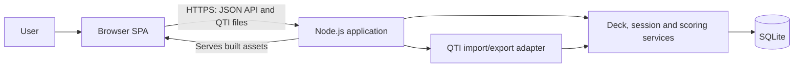

# Quizlet architecture

## Scope and assumptions

Quizlet is a web application for managing quiz decks and practising their questions. This design follows `requirements.md` and uses a Node.js server, SQLite and a browser-based single-page application (SPA). It is a proposed implementation, not a record of an existing system.

The initial deployment assumes one server instance and a local, persistent SQLite database. Accounts, sharing, offline access, deck creation and deletion, supported question types, scoring rules and QTI compatibility remain product decisions. The design must not depend on a particular answer to those questions without first confirming it.

## System overview

The SPA handles navigation, forms, question presentation and results without a full page reload. The server owns validation, question ordering, answer evaluation, scoring and persistence. A single deployable Node.js process serves the built SPA and its API; development can use a separate frontend development server with an API proxy. The server returns the SPA entry point for browser routes while keeping API and asset routes distinct.

## Proposed technology

| Component | Choice | Purpose |
| --- | --- | --- |
| Frontend | React and TypeScript, built with Vite | SPA views, routing and forms |
| Backend | Node.js, TypeScript and Express | HTTP API, static assets and application services |
| Database | SQLite with a Node.js SQLite driver and versioned migrations | Persistent local storage |
| Interchange | Server-side QTI adapter | Translate supported QTI packages and application data |
| Testing | Unit and API integration tests; Python Playwright browser tests | Verify domain rules and complete user workflows |

Use maintained, compatible dependency versions selected at implementation time. Keep database access and QTI parsing behind interfaces so their libraries can change without rewriting the domain logic.

## Application components

- **SPA:** Deck selection and configuration, question management and ordering, play session, results, and QTI import/export screens. It presents server validation and import errors to the user.
- **HTTP API:** Validates requests, returns consistent error responses, handles file transfers and delegates to services. Resource identifiers are opaque to the client.
- **Deck service:** Reads and updates decks, settings, questions and explicit question positions. Reordering is performed transactionally.
- **Session service:** Starts a session, fixes its question order, records responses and coordinates completion. Random order is chosen once per session rather than on every request.
- **Scoring service:** Evaluates responses according to the eventually agreed question types and scoring rules. It controls which feedback is returned at each stage.
- **QTI adapter:** Validates and maps the agreed QTI subset into domain models and produces exports from them. It reports unsupported or invalid content rather than silently discarding it.
- **Persistence layer:** Encapsulates SQLite queries, transactions and migrations; enables foreign-key enforcement on every connection.

## Data model

The following logical entities are a starting point; exact fields depend on the unresolved question and scoring requirements.

| Entity | Key data and relationships |
| --- | --- |
| Deck | ID, name, question ordering mode, answer-feedback setting and real-time points setting |
| Question | ID, deck ID, position, question type and prompt; type-specific content and answer data |
| Play session | ID, deck ID, status, start and completion times, settings and ordered question snapshot |
| Session response | Session ID, question snapshot reference, submitted response and evaluation data |
| Result | Session ID and calculated outcome; may be derived from persisted responses |

Question positions must be unique within a deck. Store a session snapshot sufficient to preserve the presented content, order, scoring inputs and settings if a deck is edited during play. A completed result must remain consistent with that snapshot. Define retention, history and deletion behavior when the corresponding product decisions are made.

## Main flows

1. **Manage a deck:** The SPA reads a deck and its questions, submits edits or a new order, and refreshes from the saved server state. The server validates and commits each change.
2. **Play:** The server creates a session from a deck snapshot and returns questions in the configured order. The SPA submits responses; the server evaluates them and returns correct answers and running points only when the relevant settings permit. The completion response includes the assessment result.
3. **Import:** The SPA uploads a QTI file. The server validates its package and supported content, translates it, then writes accepted changes in a transaction. On failure, it returns actionable errors and leaves the deck unchanged. Whether import targets an existing deck or creates one remains to be decided.
4. **Export:** The server translates a deck into the agreed QTI profile and returns a downloadable file. Any unsupported application features must be reported rather than represented as guaranteed round-trip data.

## API boundary

Use JSON over HTTP for application operations and multipart upload/download for QTI packages. A possible `/api` surface is:

| Operation | Endpoint |
| --- | --- |
| List and read decks; update name and settings | `GET /decks`, `GET /decks/:id`, `PATCH /decks/:id` |
| Manage questions and their order | `POST /decks/:id/questions`, `GET/PATCH/DELETE /questions/:id`, `PUT /decks/:id/question-order` |
| Start and play | `POST /decks/:id/sessions`, `GET /sessions/:id`, `POST /sessions/:id/responses`, `POST /sessions/:id/complete` |
| Read result | `GET /sessions/:id/result` |
| Import and export | `POST /decks/:id/imports`, `GET /decks/:id/export` |

The import endpoint is illustrative and depends on the import-target decision. Define request and response schemas after the question types, session rules and QTI profile are agreed. Return appropriate HTTP status codes and a consistent error body with a stable code and user-facing message. Do not send answer keys or hidden scoring data in play responses before the configured feedback permits them; management endpoints may return the data needed for editing.

## QTI compatibility

QTI is an interoperability boundary, not the internal data model. Select a QTI version, package format, supported interaction types, scoring behavior and media handling before implementation. Document the supported mapping and known losses, and test with representative external files. The architecture does not assume that all QTI content or deck settings can be round-tripped. Reject unsupported content or define an explicit partial-import policy before enabling partial imports.

## Operations and security

- Store the SQLite file outside generated assets on persistent storage; apply migrations on deployment, and use SQLite's backup mechanism for consistent backups and restore tests. Enable foreign keys and configure appropriate busy handling. A single server instance avoids assuming SQLite is a distributed database; revisit storage and concurrency if deployment scales out.
- Validate input and file sizes on the server. Parse XML with external entities and network access disabled, and protect package extraction against path traversal, excessive expansion and malformed files. Serve imported content safely and sanitise any supported rich text.
- Use HTTPS when deployed, restrict write access to the database file, and log operational errors without exposing answer keys or sensitive user data. Authentication and authorization require a separate design if multi-user access is selected.
- Store timestamps consistently in UTC. Return clear errors for invalid requests, missing resources, conflicts and failed imports.

## Testing and verification

The application is not yet implemented. The following is the proposed test strategy; add executable tests as the corresponding features and acceptance criteria are implemented.

### Test layers

| Layer | Scope and examples |
| --- | --- |
| Unit | Question ordering, answer evaluation, scoring, feedback visibility and QTI mapping. Inject a deterministic random source to test shuffling without relying on chance. Final scoring and question-type cases depend on product decisions. |
| API and database integration | Request validation and error responses; SQLite constraints and migrations; transactional question reordering and import rollback; session snapshots after deck edits; absence of hidden answers and points in play responses. Use a real isolated SQLite database. |
| Browser end-to-end | Exercise the SPA, HTTP API and database together using Python Playwright and headless Chromium, following [webapp-testing](../skills/webapp-testing/SKILL.md). Verify visible outcomes and persisted state, not just successful clicks. |
| Operational | Verify a consistent database backup and restore, production asset serving and SPA deep-link fallback while API routes still return API responses. |

### Browser scenarios

- Select a seeded deck; rename it; create, edit and delete a question; reorder questions; reload and verify the changes persist.
- Play in arranged order and verify the presented sequence and final result. For random order, verify every question appears once and the session order stays stable; use a controlled random source in lower-level tests to verify the shuffle itself.
- Cover both states of each feedback setting, including their combinations: check whether correct answers and running points are visible at the appropriate time, and inspect play API responses for data that should remain hidden.
- Import a supported QTI fixture and verify its questions appear; export a deck and validate the resulting file against the agreed QTI profile. Test malformed and unsupported files, display of an actionable error, and that a failed import leaves the deck unchanged. Add round-trip checks only for features the chosen profile supports.
- Exercise form validation and server errors, keyboard navigation, and a representative narrow viewport. Test an SPA deep link and reload. Add cases for question types, scoring, session completion and history when their rules are agreed.

### Execution and isolation

- Each test run uses a temporary SQLite database, applies migrations, and seeds known decks and QTI fixtures. Never point tests at the user's database. Reset state between tests and clean up temporary files and processes, including after failures.
- For local browser runs, use the skill's `scripts/with_server.py` to start and stop the required server or servers; run the helper with `--help` first. Wait for server readiness before launching the test. The production-build smoke test should use the Node server serving the built SPA; the development workflow may run the frontend and API separately.
- Use Python's `sync_playwright()`, launch Chromium headlessly, navigate and wait for `networkidle` before inspecting a dynamic page, then inspect the rendered DOM or a screenshot to discover selectors. Prefer accessible roles and labels; wait for meaningful UI states instead of fixed delays. Close browser resources in cleanup.
- Capture screenshots and browser console or page errors when a browser test fails, along with server output where useful. Keep artifacts free of real user data and answer keys where possible. Investigate failures rather than masking them with retries.
- Run unit and integration tests and the critical browser journeys in CI on changes; retain failure artifacts. Run the production-build smoke and backup/restore checks before release. Add browser or viewport coverage as deployment targets become known.

## Decisions needed before implementation

Resolve the open product decisions in `requirements.md`, particularly deck lifecycle, question types and scoring, session completion and history, import destination, QTI profile, and user access. These determine the final schema, API contracts and acceptance tests.
